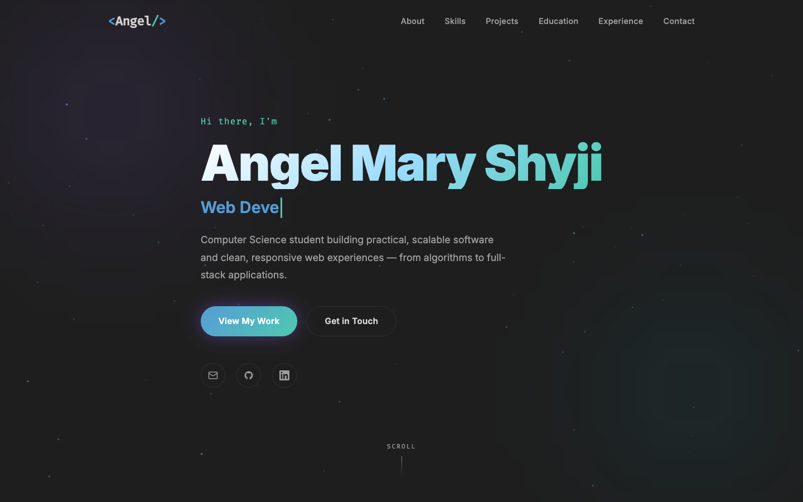
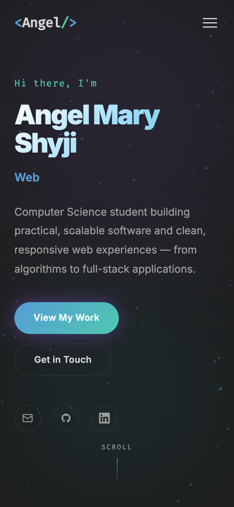

# Angel Mary Shyji — Personal Portfolio

A personal developer portfolio built with React, covering my software and web development work: skills, projects, experience, and a working contact form.

**🔗 Live demo:** [angelmaryshyji.dev](https://angelmaryshyji.dev/)

## Screenshots

  
  &nbsp;
  

## Features

- **Particle canvas** — animated background particles in the hero section
- **Typewriter effect** — cycling titles in the hero section
- **Scroll-reveal animations** — sections animate in using Framer Motion
- **Working contact form** — EmailJS integration sends messages directly to inbox
- **Fully responsive** — mobile-friendly across all breakpoints

## Tech Stack

- **React 19** — UI framework
- **Vite 8** — build tool and dev server
- **Framer Motion** — animations and transitions
- **CSS Custom Properties** — theming without a CSS-in-JS library
- **EmailJS** — contact form email delivery (no backend required)
